# Crystal Studio

**Crystal structure renders and looping movies, in your browser or on your desktop.**

Open a crystal structure, choose the molecules you want to show, and find the right view. Crystal Studio makes clean molecular figures and full-turn animations from your coordinates, with thermal ellipsoids when a CIF includes suitable displacement data. Measure distances and angles, style the annotations, and choose when they appear during rotation. Save a project to keep your structure, measurements, molecule selection, orientation, and display settings together.

**[Use online](https://sowden94.github.io/Crystal-Studio/)** · **[Download for Mac or Windows](https://github.com/Sowden94/Crystal-Studio/releases)** · **[User guide](docs/README.md)** · **[Report an issue](https://github.com/Sowden94/Crystal-Studio/issues/new/choose)**

> **Beta — under active development.** We are actively improving Crystal Studio and expect frequent updates. Features, file support, and the interface may change, and some things may not work as expected. Save your projects regularly, retain your original crystallographic files, and tell us about problems or ideas through [Issues](https://github.com/Sowden94/Crystal-Studio/issues). Desktop updates are downloaded manually from GitHub Releases; there is no automatic updater yet.
>
> **Initial distribution:** the desktop release workflow creates a **draft** release for testing. Downloads become available after the maintainer tests and publishes that draft. The online link becomes available after GitHub Pages is enabled and the Pages workflow succeeds. See [publishing setup](docs/maintainer-setup.md).

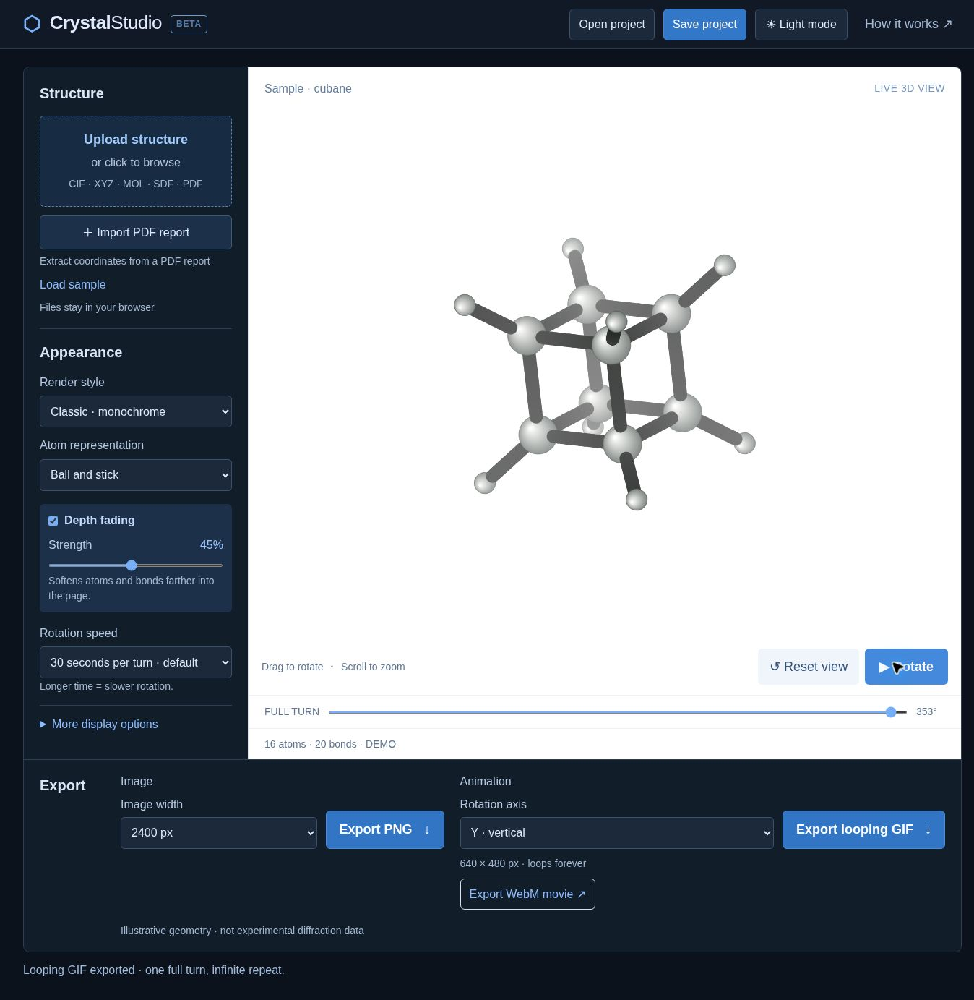

## See what you can make

| Clean monochrome figures | Space-filling views | Ellipsoid display |
|---|---|---|
| 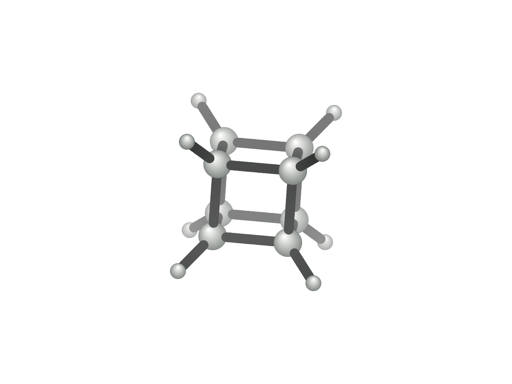 | 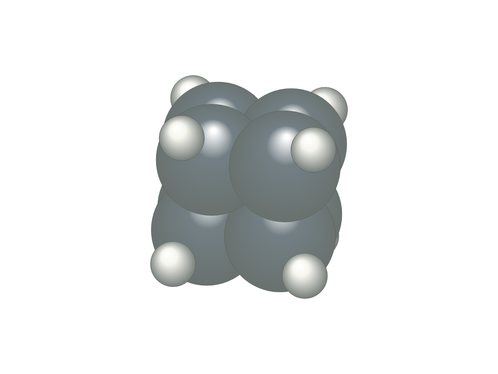 | 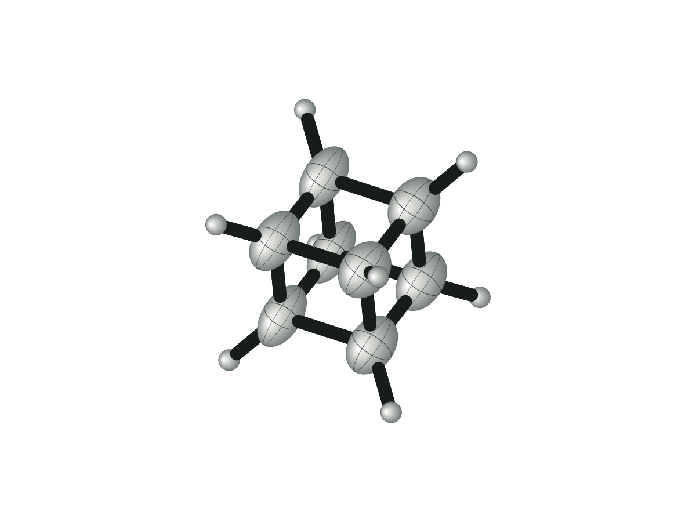 |

### New: distances and angles, styled your way

| Custom measurement labels | Measurements that fade in near a chosen view |
|---|---|
| 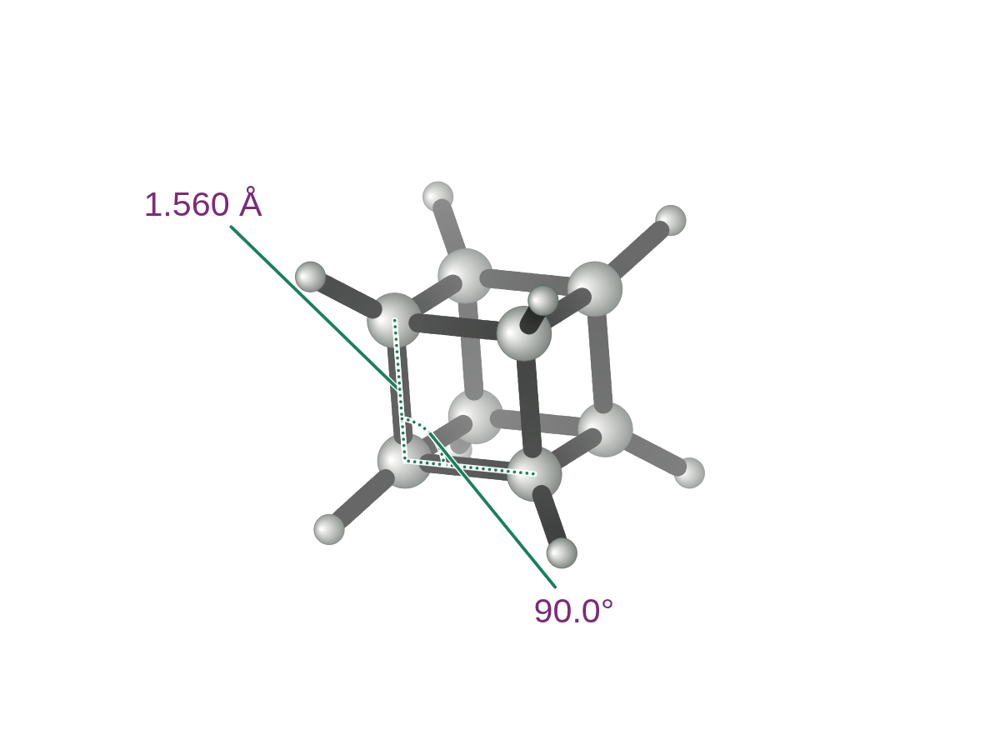 | 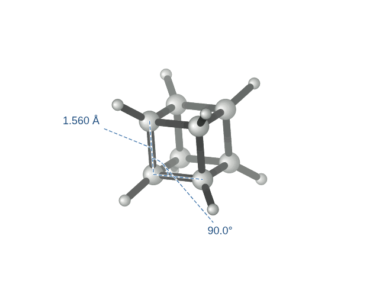 |

Measure directly on the model, drag the labels into place, and choose your text colour, line colour, line style, and size. Keep annotations visible, hide them during automatic rotation, or fade them in only near your preferred view. **[How to use measurements](docs/guide/measurements.md)**

### Add depth to your figures

The same structure and viewing angle, with distant atoms and bonds fading toward the white background.

| Depth fading off | Depth fading on · 45% |
|---|---|
| 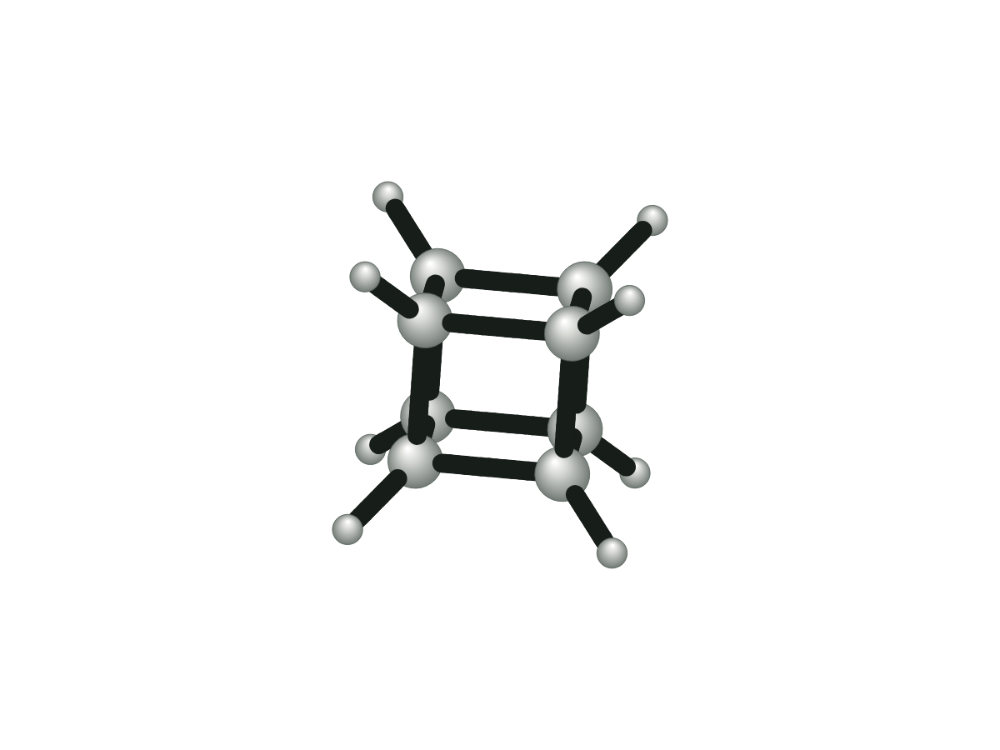 |  |

### Choose what appears in the export

| All connected groups | One selected molecule |
|---|---|
| 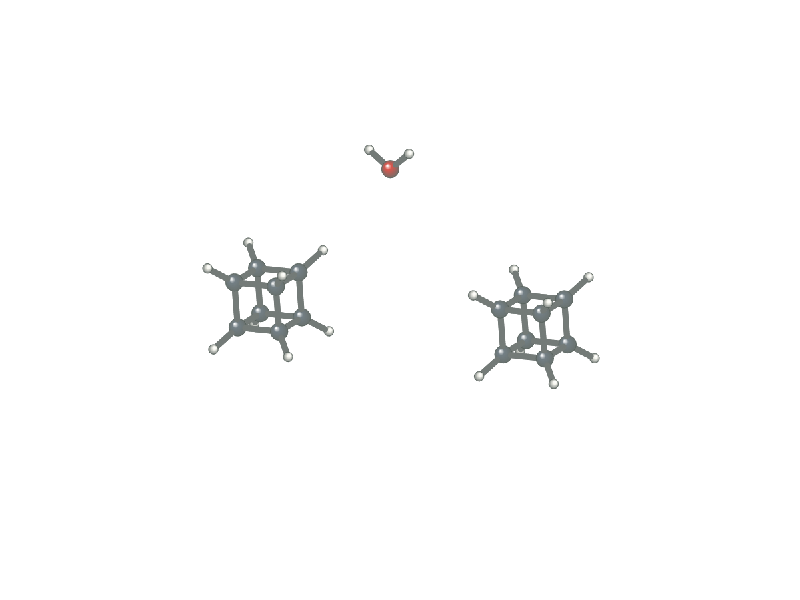 | 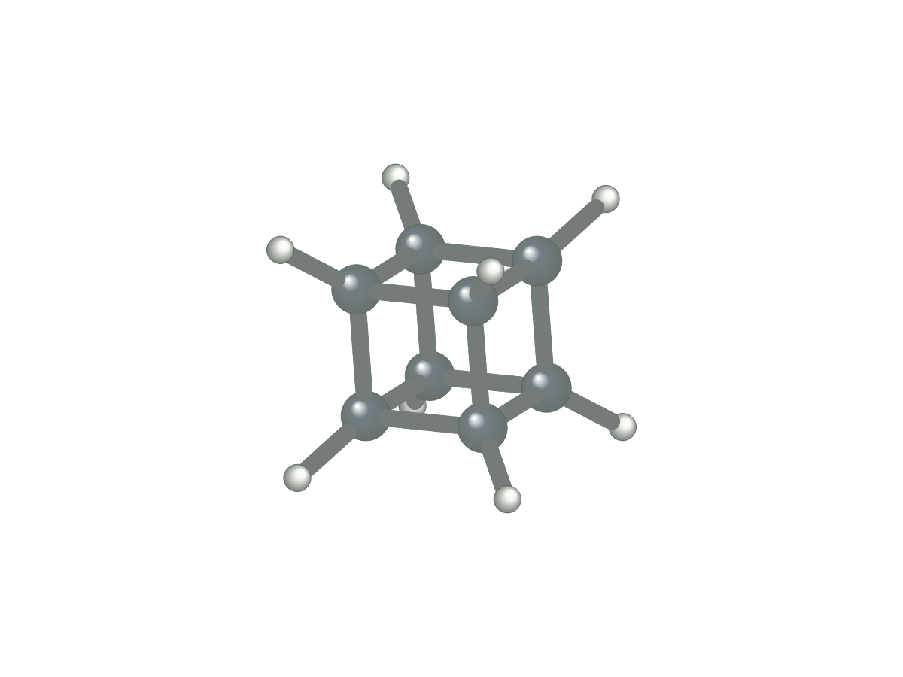 |

### Watch a full turn

| Space-filling rotation | Ellipsoid rotation |
|---|---|
| 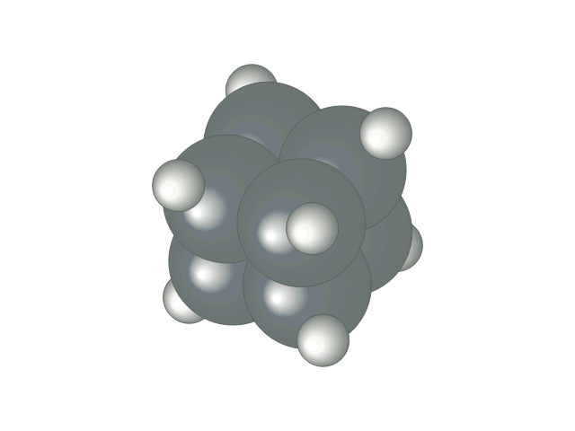 | 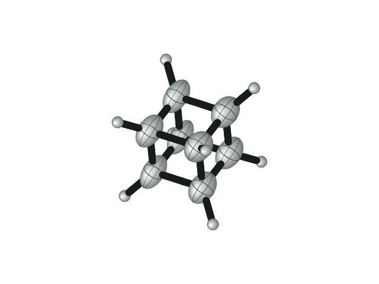 |

Video copies: **[Space-filling MP4](docs/images/space-filling-rotation.mp4)** · **[Ellipsoid MP4](docs/images/ellipsoid-rotation.mp4)**. These copies are converted from the app's exported GIFs; the app exports WebM directly. Enable repeat in your video player for continuous playback.

All examples above are actual app exports using constructed illustrative geometries. The ellipsoid example uses **constructed displacement tensors**, not experimental refinement data. See [media notes](docs/images/README.md).

## Start with your structure

Upload **CIF, XYZ, MOL, or SDF** coordinates. Drag to rotate the model, scroll to zoom, and pause at the view you want. Choose a monochrome figure, element colours, sticks, or a space-filling view. Hydrogens and atom labels can be shown or hidden.

CIF import reads fractional coordinates and converts them using the unit cell. When the file supplies symmetry-coded bond links, Crystal Studio uses those links to complete finite molecules that cross crystallographic symmetry. It keeps the molecular view separate from full crystal packing.

**[Try the cubane example](examples/cubane.xyz)** · **[Try the constructed symmetry example](examples/symmetry-demo.cif)**

The included examples are illustrative geometries, not experimental refinements.

## Choose which molecules to show

Some crystal structures contain several independent molecules, solvent, or counterions. The molecule list separates connected groups so you can untick unwanted parts, show only one group, or restore everything.

**Keep one of each** keeps one representative of groups with matching elemental connectivity. It does not prove that stereochemistry, conformation, disorder, or chemical identity is equivalent: review your choice. Every image and animation export uses the selected groups.

**[Try two cubanes and water](examples/two-cubanes-and-water.xyz)**

## Organic and inorganic structures

All 118 current element symbols are recognised, including transition metals, lanthanides and actinides. CIF and MOL/SDF connections take priority over distance guesses. CIFs with Cartesian coordinates retain reported metal–ligand bonds. For extended structures, turn **Complete finite molecules** off to display deposited sites; boundary connections are omitted. Distance-based bonding remains approximate—review coordination and contacts against the source report. See the [elements and metals guide](docs/guide/elements-and-metals.md).

## Thermal ellipsoids and depth fading

Use **Thermal ellipsoids** when a CIF contains valid anisotropic Uij or Bij parameters. Choose the ellipsoid probability, adjust bond thickness, and show or hide the ellipsoid outlines. Atoms without usable anisotropic data remain spheres.

**Depth fading** softly fades more distant atoms and bonds toward the selected background. Its strength is adjustable and follows the structure as it rotates. The same setting is used in exported figures and movies.

## Measure distances and angles

Choose **Length** and drag between two atoms, or click each atom. Choose **Angle** and select three atoms; the **second atom is the vertex**. For crowded structures, use **Choose atoms by name**. Select **Rotate** to return to turning the model.

- Distances are calculated from the 3D coordinates in **angstroms (Å)**; angles are in **degrees**.
- Drag the plain-text labels to position them. **Keep labels clear of structure** is enabled by default; turn it off for unrestricted placement, or use **Auto-place labels** to reset placement.
- Open **Measurement appearance** to choose font and line colours, text size, line thickness, and solid, dashed, dotted, or hidden measurement lines and label connectors.
- Use **During rotation** to hide measurements during automatic rotation, always show them, or show them **Near a chosen view**. For a chosen view, pause at your preferred orientation, click **Use current view**, and choose a **30°, 60°, 90°, or 120°** visibility window. The annotations fade in and out around that orientation each turn.
- **Include in exports** controls annotations in PNGs, GIFs, and WebM movies. Saved projects retain measurements, styling, label positions, and rotation visibility settings.

Measurements use the imported coordinates and do not calculate crystallographic uncertainties. See the **[measurement guide](docs/guide/measurements.md)** for details.

## Turn a structure into a looping movie

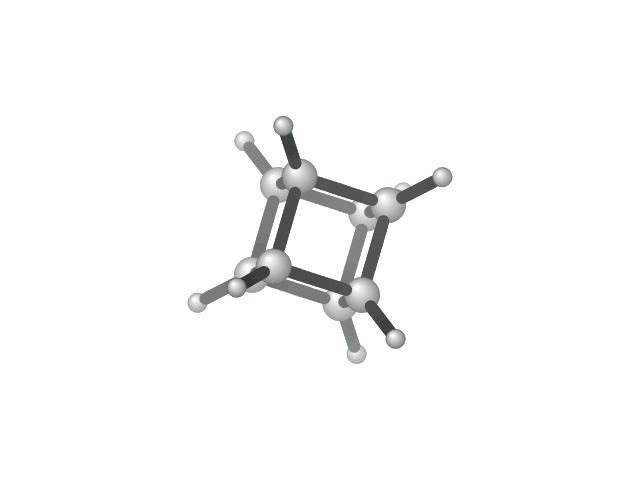

Choose the X, Y, or Z rotation axis and a speed from **4 to 60 seconds per turn**. The default is **30 seconds**. Pause, adjust the angle, or scrub through a full rotation.

- **PNG:** 1200, 2400, or 3600 pixels wide, with an optional transparent background.
- **GIF:** a complete 360° turn, set to repeat indefinitely.
- **WebM:** a full-turn video. Enable repeat in the video player when presenting it.

Animations rotate the static structural model; they are not simulations of atomic vibration or molecular dynamics. Long GIF loops use fewer frames per second to keep exports manageable. WebM is the smoother choice for long rotations.

## Extract coordinates from a PDF report

**Import PDF report** reads selectable text from a crystallographic report and looks for atomic coordinate tables and unit-cell values. Choose the table, check the coordinate type and printed scale, and review or edit the rows before rendering.

Reports that lack coordinates cannot be reconstructed from a molecular picture or refinement statistics alone. Scanned pages need optical character recognition (OCR) first. PDF import currently brings in **coordinates only**, not anisotropic displacement tensors or symmetry operations; use the CIF when available.

**[PDF import guide](docs/guide/pdf-import.md)**

## Save your work and come back to it

**Save project** creates a `.crystalstudio` file containing the full loaded model, selected molecules, orientation, zoom, display options, background, rotation speed, export resolution, and measurement annotations. **Open project** restores that state in either version of the app.

| Online | Desktop |
|---|---|
| Runs on GitHub Pages in a modern browser. Save through a browser file picker where supported, or download a project file. | Installed Mac or Windows app. Native Open, Save, Save As, and export dialogs let you choose your own folders. |
| No installation. Keep a copy of downloaded projects to reopen them later. | Works offline with bundled application files. File-menu shortcuts support project opening and saving. |

There are no accounts, cloud project storage, or automatic backups. Keep your original CIFs and reports. Unsaved browser work is lost when the page is closed or reloaded.

## A dark interface, with white paper

The interface opens in dark mode, with blue controls and a white molecular workspace. A light/dark button switches the interface theme and remembers your choice on that computer. The workspace background is chosen independently under display options, so changing the interface theme does not recolour an exported figure.

## Install

When a release is published, download the file for your computer from **[Releases](https://github.com/Sowden94/Crystal-Studio/releases)**.

| Computer | Download |
|---|---|
| Mac with Apple silicon | macOS `arm64` DMG or ZIP |
| Mac with an Intel processor | macOS `x64` DMG or ZIP |
| Windows 64-bit | `windows-x64-setup.exe` installer, or Windows ZIP for a portable folder |

The first beta packages are **unsigned**, and Mac packages are **not notarized**. Native platform testing is required before public distribution. Signing and notarization are separate release tasks; the project does not bundle signing credentials. See [installation and updates](docs/guide/getting-started.md).

## Learn, report, and contribute

- **[User guide](docs/README.md):** imports, molecular selection, rendering, saving, and export.
- **[Known limitations](docs/guide/limitations.md):** supported crystallography and beta caveats.
- **[Contributing](CONTRIBUTING.md):** development setup and pull requests.
- **[Security](SECURITY.md):** handling a suspected vulnerability.
- **[Changelog](CHANGELOG.md):** changes between releases.

The repository's **Code**, **Issues**, **Pull requests**, **Actions**, **Releases**, and **Security** areas hold the source, feedback, proposed changes, build history, downloads, and security information. GitHub controls those tabs; the README does not replace them. Discussions or a Wiki can be enabled by the repository owner later.

## For developers

The browser app uses JavaScript, Three.js, PDF.js, and gifenc. The desktop version wraps the same local app in Electron, with a sandboxed renderer and native file dialogs. GitHub Actions publishes the online version through GitHub Pages and builds desktop downloads on Mac and Windows runners.

```sh
npm ci
npm run check
npm test
npm start
```

Use `npm run build:web` for the static Pages output. Use `npm run desktop:mac` on macOS or `npm run desktop:windows` on Windows for distributable builds. See [developer notes](docs/developers.md).

## Licence

Crystal Studio is free software under the **[GNU General Public License, version 3](LICENSE)** (**GPL-3.0-only**). You may use, study, modify, and redistribute it under those terms. Distributed modified versions must meet the GPLv3 source and licensing requirements. The software is provided without warranty.

Copyright © 2026 M. J. Sowden.

Bundled dependencies retain their own licences. See **[third-party notices](THIRD-PARTY-NOTICES.md)** and the licence texts in `third-party-licenses/`. Electron desktop distributions also include Electron's and Chromium's notices.

The organisation of this page was inspired by [Chem Illustrator](https://github.com/nathanohare/Chem-Illustrator). Crystal Studio is an independent application; no Chem Illustrator application code or demonstration images are included.
